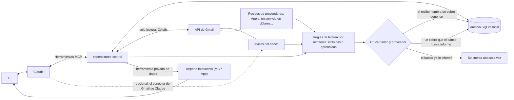

# Expenditures Control

**Los correos de tu banco, convertidos en un reporte de gastos vivo dentro de Claude.**
Un servidor MCP local que lee los avisos que tu banco ya te manda, guarda los movimientos en tu computador y muestra un reporte interactivo, al estilo Power BI, dentro de la conversación.

[Read in English](README.md)


## Por qué existe

Cada compra y cada transferencia dispara un correo de tu banco. Es la única fuente de datos que sirve con cualquier banco, no necesita una API bancaria ni tus credenciales y ya está en tu bandeja. Este proyecto convierte esos correos en datos estructurados que son tuyos, y te deja explorarlos conversando con Claude **o** haciendo clic en un reporte que vive en el chat.

- **Cualquier banco, cualquier país.** BBVA Colombia viene incluido. Para otro banco le muestras a Claude 3 o 4 avisos reales y aprende las reglas de lectura, que el servidor prueba contra tus ejemplos antes de guardarlas.
- **Bancos más fuentes externas.** El banco dice `Apple.com/bill` y nada más; el recibo del proveedor dice qué aplicación era. Los recibos de tiendas y servicios se leen igual que los avisos del banco y se cruzan con lo que el banco informó.
- **Un reporte con el que se puede jugar.** Haz clic en una categoría, un comercio o un día y todos los gráficos, el ranking y la tabla resaltan esa misma selección.
- **Pregunta en lenguaje natural.** "No encuentro la transferencia del alquiler" abre el reporte en el mes correcto con ese movimiento resaltado.
- **Local primero.** Tus datos viven en un solo archivo SQLite en tu computador. Sin nube, sin cuenta.


## Míralo en una conversación

| Tú dices | Qué pasa |
|---|---|
| "Muéstrame mis gastos" | El reporte interactivo aparece dentro de la conversación: tu ritmo frente al mes anterior, categorías, un gráfico día a día y una tabla con búsqueda. |
| "No encuentro la transferencia del alquiler" | Claude entiende "alquiler" por tu lista de gastos fijos, abre el mes correcto y resalta el movimiento. |
| "¿Qué suscripciones estoy pagando que no tengo anotadas?" | Compara lo que se cobró de verdad con tu lista y muestra las olvidadas. |
| "Aprende los avisos de mi banco Galicia" | Claude te pide 3 o 4 correos reales, confirma contigo cómo se lee cada uno, redacta las reglas y las guarda solo si todos los ejemplos pasan. |
| "Sincroniza los correos de mi banco desde septiembre" | Con Gmail conectado, el servidor descarga y lee los correos por su cuenta y devuelve solo un resumen corto. |

## Lo más importante

- **Reporte interactivo como MCP App**, dibujado dentro de Claude (y Claude Desktop). El modelo solo recibe un resumen corto: el reporte pide sus datos con una herramienta privada, así que tus movimientos nunca entran al contexto del modelo.
- **Formatos de banco aprendidos.** Reglas declarativas, validadas con un esquema, por remitente; probadas contra ejemplos confirmados y guardadas en tu base. Las reglas aprendidas tienen prioridad sobre las incluidas, así que un banco se puede reenseñar cuando cambian sus correos.
- **Sincronización de Gmail desde el servidor.** OAuth de solo lectura (PKCE, loopback), con el token guardado localmente. Meses de historial se cargan en segundos sin pasar por el modelo.
- **Recibos que completan el cuadro.** Un recibo puede nombrar en qué fue un cobro genérico de la tarjeta, cruzado por monto y fecha; y un recibo en dólares de un comercio que tu banco nunca informa se convierte con la tasa oficial de ese día y queda marcado como estimado, sin contar jamás un cobro dos veces.
- **Gastos fijos y suscripciones olvidadas.** Importas una hoja con lo que esperas pagar; el servidor te dice qué se pagó, qué falta y qué pagas sin tenerlo anotado. Los pagos PSE, que ocultan al beneficiario, se emparejan por monto.
- **Contabilidad sensata.** Las conversiones de USD a COP cuentan como ingreso, los pagos de tarjeta de crédito son transferencias propias (sin doble conteo), y PSE y las transferencias a personas tienen su propia categoría.
- **Segura por construcción.** CSP estricta, token secreto y solo `127.0.0.1` para el navegador; las expresiones regulares propuestas por un modelo corren en un contexto aislado con límite de tiempo; el texto tomado de los correos se limpia y se limita en longitud.


## Cómo funciona



El servidor no tiene modelo de lenguaje. Claude hace lo que requiere criterio (clasificar comercios, explicar, aprender un banco nuevo desde ejemplos); el servidor valida, guarda, agrega y extrae. El flujo completo está en [docs/diagrama-proceso-mcp.md](docs/diagrama-proceso-mcp.md).

## Empezar

**Requisitos:** Node.js 22.13 o superior (el servidor usa `node:sqlite`, que viene incluido) y Claude Desktop (o cualquier cliente MCP que ejecute servidores stdio; las MCP Apps necesitan un cliente que las soporte, como Claude Desktop).

### Claude Desktop (paquete de un clic)

```bash
git clone https://github.com/estebanjc78/expenditures-control.git
cd expenditures-control
npm install
npm run build:mcpb        # genera build/expenditures-control.mcpb
```

Abre `build/expenditures-control.mcpb` con Claude Desktop y pulsa **Instalar**. Permite el reporte cuando Claude lo pida.

### Claude Code u otros clientes

```bash
npm install && npm run build
claude mcp add gastos -- node "/ruta/absoluta/a/dist/index.js"
```

Define `GASTOS_DB=/ruta/a/gastos.db` en el entorno del servidor para elegir dónde queda la base (por defecto `~/.gastos-mcp/gastos.db`). Si el cliente no soporta MCP Apps, `abrir_panel` abre el mismo panel en tu navegador.

### Primeros pasos

1. **Agrega el remitente de tu banco:** "Agrega `BBVA@bbvanet.com.co` como remitente de banco." Para otro banco, mira [Bancos y proveedores](#bancos-y-proveedores).
2. **Carga movimientos.** O le pides a Claude que lea correos recientes con su propio conector de Gmail, o conectas Gmail al servidor una sola vez ("Conecta mi Gmail") y pides "Sincroniza los correos de mi banco desde 2026-09-01". Mira [docs/gmail-setup.es.md](docs/gmail-setup.es.md).
3. **Míralo:** "Muéstrame mis gastos."
4. **Opcional:** importa una hoja de gastos fijos y fija un presupuesto ("Fija un presupuesto de supermercado de 4.000.000 para todos los meses").

Hoja de gastos fijos: la primera hoja, con encabezados `nombre`, `monto`, `comercio` (la palabra clave para detectar el pago: palabras completas, sin distinguir tildes ni mayúsculas; un `*` al final también acepta una última palabra truncada, como `compania de med*`). Importar reemplaza la lista anterior.

## Bancos y proveedores

### Bancos

BBVA Colombia viene incluido: compras, dinero recibido (Bre-B y transferencias), transferencias propias, transferencias a personas, pagos PSE, pagos de facturas y pagos de tarjeta de crédito.

Para cualquier otro banco, **enséñaselo con ejemplos**: agrega el remitente, pídele a Claude que aprenda ese banco, confirma cómo se leen 3 o 4 de tus avisos reales y las reglas quedan guardadas en tu base. Detalles, formato de las reglas y modelo de seguridad: [docs/learn-a-bank.es.md](docs/learn-a-bank.es.md). Está probado con ejemplos inventados de Argentina y México, todavía no con correos reales de esos bancos.

### Proveedores (recibos de tiendas y servicios)

Un proveedor es cualquier remitente cuyos correos dicen más sobre tu plata que el banco. Se le enseña con ejemplos igual que a un banco, y cada plantilla de recibo hace una de tres cosas:

| Trabajo | Ejemplo | Qué pasa |
|---|---|---|
| **Enriquecer** | El banco informa `Apple.com/bill` $24.000; el recibo de Apple dice "Plan Individual de una app de música" | El movimiento con ese monto y fecha (hasta 3 días de diferencia) recibe el nombre del producto; su comercio y su categoría no cambian. Si todavía no encaja ninguno, el recibo espera a la próxima sincronización y se abandona a los 30 días. |
| **Completar** | Un servicio cobra en dólares una tarjeta que tu banco no informa | El recibo se registra en pesos con la tasa oficial de ese día y queda marcado como estimado. Sin tasa, va a revisión. |
| **No duplicar** | El banco ya informó ese mismo cobro en dólares | El recibo se omite. |

El cruce es conservador a propósito: solo cambia un movimiento cuando hay exactamente uno que es el más cercano, y nunca toca un movimiento de otro comercio u otro monto. Otros proveedores que encajan en el mismo patrón: tiendas de aplicaciones, apps de transporte y domicilios, servicios públicos, cualquier servicio que mande un recibo por correo. Mira [docs/learn-a-bank.es.md](docs/learn-a-bank.es.md).

## Herramientas (25)

<details>
<summary>Ver todas las herramientas</summary>

| Herramienta | Qué hace |
|---|---|
| `ver_panel` | Muestra el reporte interactivo dentro de la conversación; `resaltar` marca los movimientos que buscas (un concepto de gasto fijo, un nombre, un monto o una categoría). |
| `datos_panel` | Herramienta privada con la que el reporte pide sus datos; el modelo nunca la ve. |
| `abrir_panel` | Abre el mismo panel en una ventana del navegador (local, solo lectura). |
| `registrar_movimiento` / `registrar_movimientos` | Guarda un movimiento, o hasta 100 por lote; `sourceId` (el id del correo) evita duplicados. |
| `consultar_movimientos` | Filtra y agrupa movimientos (por categoría, banco, comercio, día o mes). |
| `clasificar_comercio` / `clasificar_comercios` | Asigna una categoría a un comercio, o a muchos a la vez, y reclasifica sus gastos. |
| `fijar_presupuesto` / `estado_presupuesto` | Fija un presupuesto; gastado contra presupuesto por categoría, con alerta al 80%. |
| `importar_gastos_fijos` / `gastos_fijos_pendientes` | Carga la lista de gastos fijos; qué se pagó y qué falta. |
| `gastos_recurrentes_no_listados` | Suscripciones y cobros fijos que pagas y no están en tu lista. |
| `ultimo_movimiento_registrado` | Fecha del último movimiento por banco. |
| `listar_remitentes` / `agregar_remitente` / `quitar_remitente` | Administra los remitentes autorizados. |
| `filtrar_no_registrados` | De una lista de ids de correo, los que todavía no están registrados. |
| `conectar_gmail` / `estado_gmail` / `desconectar_gmail` | Conecta Gmail (solo lectura), lo consulta, o borra el token local. |
| `sincronizar_gmail` | Descarga y lee los correos de un rango de fechas; devuelve un resumen. |
| `formatos_banco` | Qué bancos y proveedores se pueden leer (incluidos y aprendidos) y qué remitentes todavía necesitan reglas. |
| `configurar_formato_banco` / `eliminar_formato_banco` | Aprende un banco o proveedor desde ejemplos confirmados (se guarda solo si todos pasan), o borra sus reglas. |

</details>

## Privacidad y seguridad

- **Local primero.** Un solo archivo SQLite en tu computador. El único tráfico de red es hacia las APIs de Google cuando conectas Gmail y, solo si un recibo en dólares necesita convertirse, una consulta al servicio de datos abiertos del gobierno colombiano por la tasa oficial de ese día (lleva una fecha, nada más).
- **Gmail de solo lectura** (`gmail.readonly`), solo para los remitentes que autorizas, solo para extraer datos de movimientos. El token vive en `~/.gastos-mcp/gmail-token.json` (permisos solo para el dueño); `desconectar_gmail` lo borra y puedes revocar el permiso en <https://myaccount.google.com/permissions>.
- **Solo se guardan datos extraídos**: fecha, monto, comercio, banco, tipo y categoría, más una descripción corta del producto cuando un recibo lo nombra; nunca el texto de un correo.
- **El reporte no alimenta al modelo.** Sus datos llegan por una herramienta que el modelo no puede llamar, así que los movimientos quedan fuera del contexto de la conversación; el modelo recibe un resumen corto.
- **Refuerzo del panel en navegador:** solo `127.0.0.1`, token secreto en el fragmento de la URL, otros encabezados `Host` rechazados, CSP con nonce, solo lectura, nada se carga de internet.
- **La entrada no confiable se trata como tal:** el texto de los correos tiene tope de tamaño, los parsers evitan expresiones regulares propensas al retroceso, las expresiones aprendidas corren en un contexto aislado con límite de 150 ms, y los valores tomados de los correos se limpian antes de llegar al modelo.
- Cuando Claude lee tus correos o consulta tus datos, ese contenido se procesa bajo los términos de privacidad de tu cliente de Claude.

## Notas de ingeniería

- **MCP de punta a punta.** 25 herramientas por stdio, más una MCP App (recurso `ui://`) con una herramienta de datos privada solo para la app.
- **Reglas como datos, no como código.** Un perfil validado con esquema por remitente (etiquetas, expresiones regulares, valores fijos, formatos de fecha, moneda, zona horaria), probado contra ejemplos antes de guardarse.
- **Sincronización idempotente y reanudable.** Los correos ya procesados o descartados no se vuelven a descargar; los rangos grandes continúan donde quedaron.
- **Probado.** 316 pruebas unitarias y de integración (parsers con entradas hostiles, OAuth con un Google simulado, el protocolo MCP en memoria, guardas de CSP), TypeScript con verificación de tipos, y una prueba de empaquetado que instala el tarball y habla con él por stdio.
- **Revisado.** El código de Gmail y de lectura pasó por una revisión de seguridad cuyos hallazgos (ReDoS, correos envenenados, manejo del token, validación del remitente) se corrigieron y se cubrieron con pruebas.

## Limitaciones y hoja de ruta

- La sincronización de Gmail desde el servidor necesita un cliente OAuth de Google; mientras Google no verifique la app muestra una pantalla de "app no verificada" y permite 100 usuarios en total. Está cubierta por pruebas con un Google simulado y el mantenedor la ejecutó de punta a punta contra un buzón real (avisos de BBVA, recibos de Apple y de Anthropic). Mientras la app no esté publicada, Google vence el permiso cada 7 días.
- Los impuestos y cargos del banco que ningún correo trae (4x1000, IVA, comisiones, cuotas de manejo) no se reflejan; el reporte lo aclara al pie del gráfico.
- Todavía no hay una herramienta para editar o borrar un movimiento; las reversiones de compras todavía no están modeladas.
- Una moneda por base de datos (COP). Solo el USD tiene una fuente de tasa de cambio (la tasa oficial colombiana); otras monedas extranjeras se reportan para revisión en lugar de registrarse.
- Claude solo puede manejar el reporte cuando lo abre; mover desde la conversación un reporte ya abierto requiere un conector remoto (planeado).
- El servidor confía en la dirección `From` que informa Gmail y todavía no verifica DKIM por su cuenta.
- Los recibos de proveedores solo se leen cuando el servidor lee Gmail por su cuenta; por el conector de Gmail de Claude, el asistente tendría que registrarlos a mano.
- Hoja de ruta: más proveedores incluidos, una revisión que marque un cobro del banco sin recibo que le corresponda, un conector remoto (se agrega por URL, funciona en web y celular), editar y borrar movimientos, reversiones, más bancos y monedas.

## Desarrollo

```bash
npm install
npm test             # 316 pruebas
npm run typecheck
npm run build
npm run smoke:pack   # empaqueta, instala el tarball en una carpeta temporal y revisa las 25 herramientas por stdio
npm run build:mcpb   # genera build/expenditures-control.mcpb
npm run panel:demo   # abre el reporte con datos inventados (compila primero)
```

Solución de problemas: si no se encuentra `node:sqlite`, tu Node es anterior a 22.13 (un cliente con interfaz puede lanzar un Node distinto al de tu terminal); si las herramientas no aparecen, reinicia el cliente; los datos viven en `GASTOS_DB` o en `~/.gastos-mcp/gastos.db` (haz una copia del archivo y de sus vecinos `-wal`/`-shm` con el cliente cerrado).

## Licencia

[MIT](LICENSE) © 2026 Esteban J. Campos
